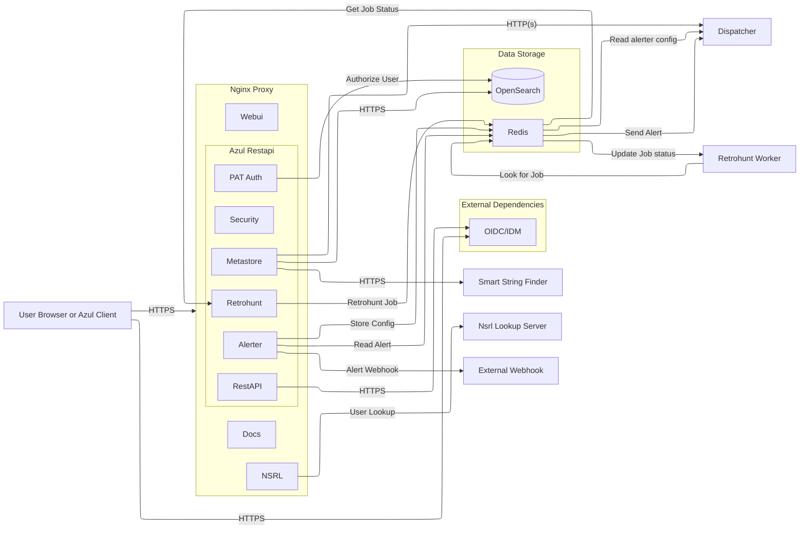
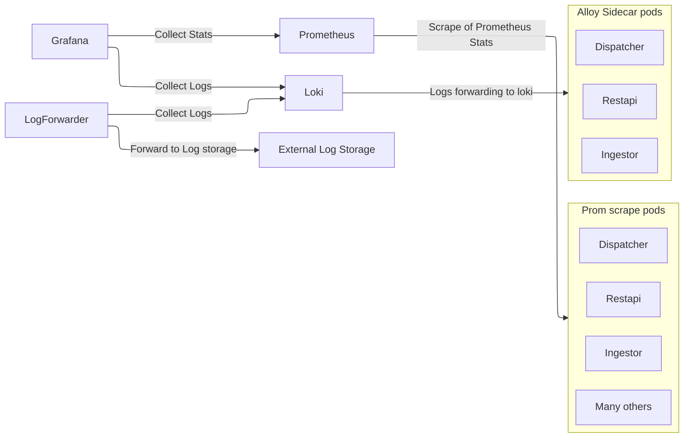

# Other Architecture

## Restapi

A more detailed view of how restapi is broken down with it's various plugins and what they contact.

In brief:

Restapi has the following plugins:

- metastore (does all the bulk of the binary work upload/download kafka jobs)
- security
- pat auth (Optional - authenticates PAT tokens created by Admins)
- alerter (Optional - configured to raise conditional alerts)
- retrohunt (Optional - if retrohunt is enabled, allows for retrohunts to be performed.)

The proxy hosting Restapi also hosts:

- Docs
- Webui
- NSRL (Optional - only if NSRL is configured)

## Monitoring

Grafana, prometheus and Loki are used for logging and monitoring Azul.

Included with that is a log forwarder that forwards loki logs to an external server for long term storage.

A pod called stats is also used to probe other components of Azul to verify if they are up or down and in a read/write state.

Burrow is another important pod that is used to query Kafka and gather statistics for Prometheus to scrape.

Pods that are scraped by prometheus:

- Dispatcher
- Restapi
- Backup
- Restore
- Ingestors
- Smart String Filter
- Assemblyline Receiver
- Retrohunt Worker
- Burrow
- Stats
- VT Filefeed Server
- Kafka

Pods that use a promethus Push Gateway for stats:

- azul-plugin-report-feeds

Pods that use Alloy to forward logs to Loki:

- Dispatcher
- Restapi
- Ingestors

